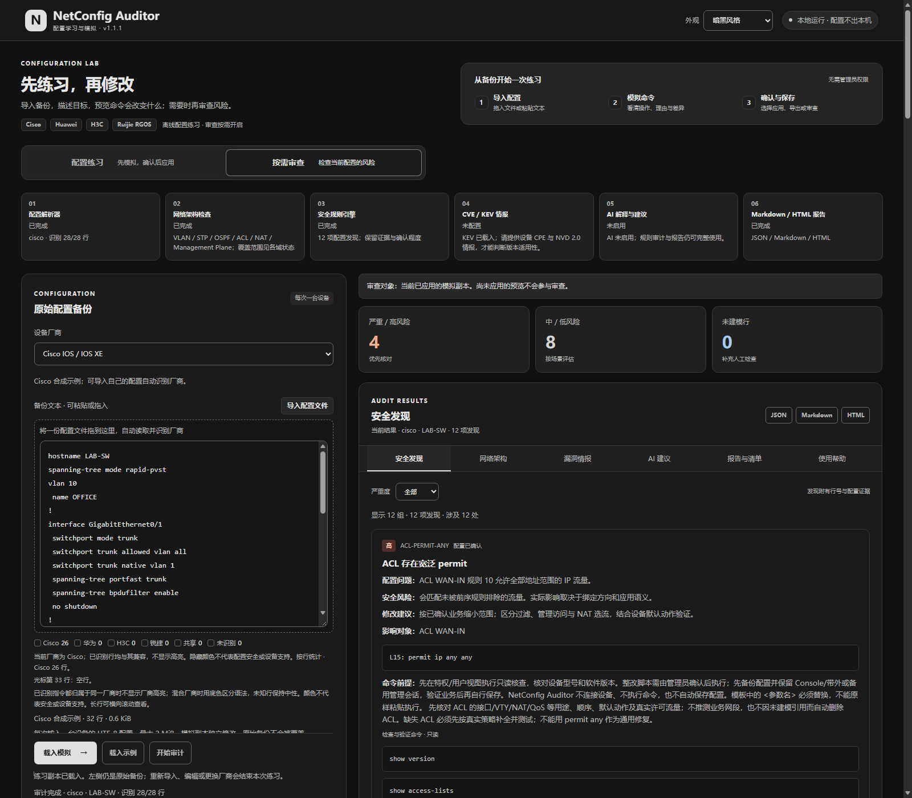
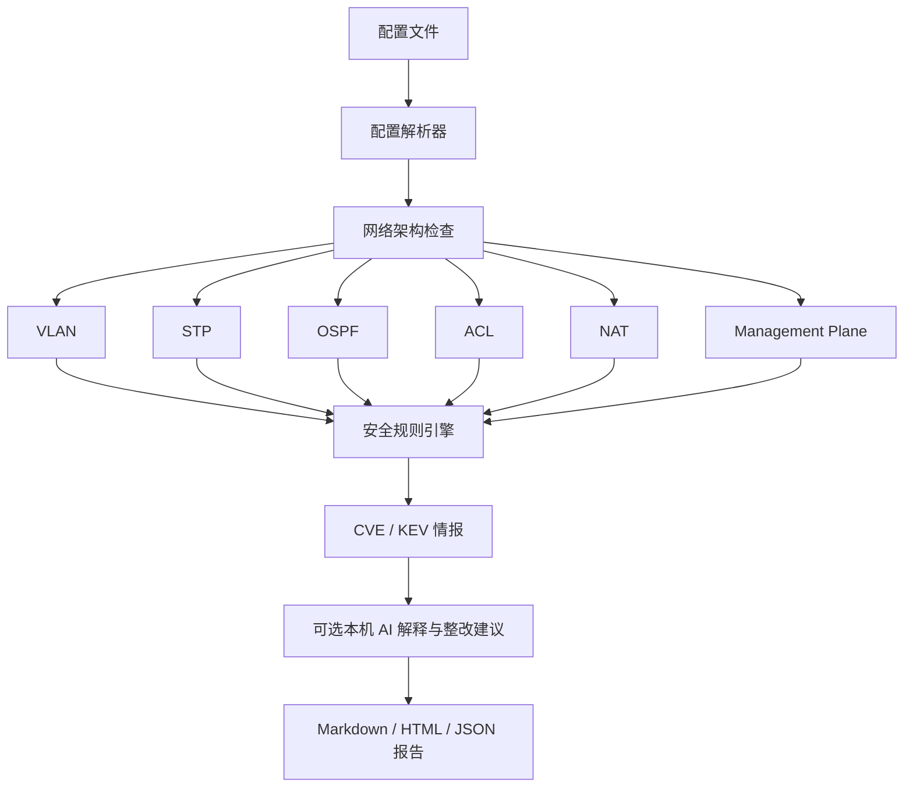

# NetAudit · 网络配置审计工具

导入 Cisco、华为或 H3C 的设备配置，完成六个领域的网络架构检查、安全规则审计和本地 CVE / KEV 情报核对；可选使用本机 AI 解释发现，导出 JSON、Markdown 或 HTML 报告。配置处理在本机完成，工具不会连接设备或下发命令。

**[v0.2.1 已发布](https://github.com/klwb360/NetAudit/releases/tag/v0.2.1)**，提供新版网页工作区、Windows 便携 ZIP、单 EXE 包、单 EXE 和对应源码；[v0.2.0](https://github.com/klwb360/NetAudit/releases/tag/v0.2.0) 与 [v0.1.0](https://github.com/klwb360/NetAudit/releases/tag/v0.1.0) 保留下载。正式文件、校验值和实测结果见 [交付记录](DELIVERY.md)。

**[下载 Windows 便携版](https://github.com/klwb360/NetAudit/releases/latest)** · [v0.2.1 发布页](https://github.com/klwb360/NetAudit/releases/tag/v0.2.1) · [使用说明与常见问题](docs/FAQ.md) · [故障排查](docs/TROUBLESHOOTING.md)

新版将配置输入与结果分区，增加六个结果页签和集中显示的操作状态。源码、便携文件夹版与单 EXE 已完成对应版本验收，下载后即可使用。

[下载与双击](#windows下载后双击使用) · [新版网页怎么用](#新版网页怎么用) · [审计流程](#审计流程) · [命令行](#源码与命令行) · [文档索引](#文档导航)

## Windows：下载后双击使用

1. 登录有权访问本私人仓库的 GitHub 账号，下载 [推荐便携 ZIP](https://github.com/klwb360/NetAudit/releases/download/v0.2.1/NetAudit-0.2.1-windows-x64-befb38bbecbb-portable.zip)，或在 [最新 Release](https://github.com/klwb360/NetAudit/releases/latest) 的 **Assets** 选择名称以 `-portable.zip` 结尾的文件。
2. 将便携 ZIP **解压一次**；不要在 ZIP 预览窗口中运行。普通使用无需下载页面自动生成的 “Source code”。
3. 双击解压文件夹中的 `Start-NetAudit.bat` 或 `NetAudit.exe`，浏览器会自动打开。若未打开，复制启动窗口显示的实际地址到浏览器。
4. 导入 UTF-8 配置、选择厂商，点击“开始审计”；也可先使用“载入示例”。
5. 查看发现、严重度和证据，点击 JSON、Markdown 或 HTML 导出。

**关闭程序**：回到启动窗口按 Ctrl+C。关闭浏览器标签页不会停止服务。**迁移电脑**：复制整个便携文件夹，包括 `_internal`，再双击使用。便携 EXE 自带 Python 运行库，普通使用设计为无需安装 Python 或使用管理员权限。

| 下载内容 | 用途 |
|---|---|
| `*-portable.zip` | 推荐。包含 EXE、运行库、BAT、说明、示例、许可证与对应源码。必须保留整个文件夹。 |
| `*-onefile.zip` | 单 EXE 及配套资料；启动时使用用户临时目录，可能比便携文件夹版稍慢。 |
| `*-onefile.exe` | 可独立运行的单 EXE；再次分发时仍需提供许可证、归属说明与对应源码。 |
| `*-source-*.zip` | 对应完整源码，用于查阅、修改与重建。普通使用无需解压源码。 |

Release 同时提供 `SHA256SUMS.txt`、构建清单与验收报告，发布时复用已验收的原始文件。源码提交、SHA-256 和实测范围见 [交付记录](DELIVERY.md)。仓库保持私人，Release 下载也需要访问权限。

开发或备份获取途径：[Windows 构建列表](https://github.com/klwb360/NetAudit/actions/workflows/netaudit-windows.yml) 的 Actions 产物仍可下载，但有保留期限；它包含外层产物 ZIP，需先解压外层，再解压其中的 `portable.zip`。Release 直接提供内部便携 ZIP，只需解压一次。不同构建使用各自的校验值。

## 新版网页怎么用



宽屏顶部显示审计概览与入门提示，左侧准备配置，右侧查看统计和结果；窄屏会按顺序堆叠。先选择厂商、导入或粘贴配置，再点击“开始审计”。设备版本与本地情报、本机 AI 设置按需展开，普通审计无需填写。

| 结果页签 | 查看内容 |
|---|---|
| 安全发现 | 按严重度筛选配置问题，核对原始行号、证据、风险和建议。 |
| 网络架构 | 查看 VLAN、STP、OSPF、ACL、NAT、Management Plane 的覆盖与待复核项。 |
| 漏洞情报 | 查看本地 CVE / KEV 来源、版本匹配及未确认候选。 |
| AI 建议 | 查看显式启用的本机模型解释，以及未启用或失败状态。 |
| 报告与清单 | 下载 JSON、Markdown、HTML，查看结构化清单和未建模行。 |
| 使用帮助 | 查看输入要求、关闭、迁移和检查边界。 |

页签切换和严重度筛选只调整显示。修改配置、厂商、设备版本、情报文件或 AI 设置后，需要重新点击“开始审计”，结果才对应新输入。操作与状态栏会提示导入、审计、完成或需要重审；配置不会持久保存，刷新后请重新导入。默认审计不依赖云端服务，可选 AI 只连接本机 Ollama。

详细操作见 [Windows 使用说明](network-config-auditor/docs/WINDOWS.md#新版网页工作区)，当前下载和真实验证结果见 [交付记录](DELIVERY.md)。

## 能做什么

- 解析 Cisco IOS/IOS XE、Huawei VRP、H3C Comware 的常见 IPv4 配置。
- 按 VLAN、STP、OSPF、ACL、NAT、Management Plane 六个领域展示检查覆盖与待复核问题，保留原有 27 条配置规则并增加 8 条 STP / OSPF 规则，共 35 个规则 ID。
- 展示接口、VLAN、STP、OSPF、路由、ACL、NAT 清单，以及未建模配置行的警告。
- 随包提供 CISA 官方 KEV 离线快照；输入精确产品 CPE 与本地 NVD CVE 2.0 数据后进行版本适用性核对，无法确认的项保持候选状态。
- 显式启用本机 Ollama 后提供 AI 解释与整改建议；未设置模型时不调用 AI，失败仍保留审计报告。
- 提供中文网页、严重度筛选、三厂商示例、文件导入及三种报告导出。
- 保留命令行、标准输入、严格模式与严重度退出码，便于本地批量处理。

审计仅覆盖已建模语法。Cisco ASA/NX-OS、IPv6、复杂策略及完整动态路由语义等尚未完整覆盖。没有告警不能视为配置已安全；建议命令需结合设备版本、拓扑和业务人工核对。完整 [支持范围](network-config-auditor/README.md#支持范围) 与 [规则说明](network-config-auditor/docs/RULES.md) 可供查阅。KEV 记录表示相关漏洞曾在现实中被利用，不能证明当前设备受影响或已被入侵。

## 审计流程



六个领域的状态描述当前输入的检查覆盖，不能证明真实拓扑或运行状态。默认使用本地快照，不联网；显式 `intel-update` 才下载官方 KEV。AI 需要自行安装和运行 Ollama 并选择本机已有模型，只影响可选解释功能，便携版的配置审计仍无需安装 Python。详见 [情报使用说明](network-config-auditor/docs/INTELLIGENCE.md)与 [AI 使用说明](network-config-auditor/docs/AI.md)。

## 源码与命令行

源码运行需要 Python **3.10 或更新版本**，运行时仅使用标准库。在仓库根目录执行：

```bash
cd network-config-auditor
python -m netaudit
```

无参数默认启动本地网页并打开浏览器。默认端口为 8765；端口占用时会选择空闲端口，以启动窗口显示的 `http://127.0.0.1:端口` 为准。

```bash
# 启动网页，但不打开浏览器
python -m netaudit serve --no-browser

# Cisco 示例导出 HTML 报告
python -m netaudit audit examples/cisco.cfg --vendor cisco --format html --out reports/cisco.html

# 华为示例导出 JSON；Markdown 的格式参数为 md
python -m netaudit audit examples/huawei.cfg --vendor huawei --format json --out reports/huawei.json

# 使用精确设备 CPE 与本地 NVD 数据核对 CVE；文件格式见情报说明
python -m netaudit audit device.cfg --asset-info asset.json --nvd-file nvd-subset.json --format html --out reports/device.html

# 显式下载官方 KEV 到用户指定位置；审计时用 --kev-file 指定
python -m netaudit intel-update --out reports/kev.json

# 可选：调用本机已安装的 Ollama 模型；模型名需替换成实际名称
python -m netaudit audit device.cfg --ai-model YOUR_INSTALLED_MODEL --format md --out reports/device.md
```

Windows 可使用 `py -3`，Linux 常用 `python3`。便携版可以用 `NetAudit.exe` 或 `Start-NetAudit.bat` 传递相同参数。退出码：0 调用成功；1 达到 `--fail-on` 指定严重度；2 参数、输入或文件错误，或 `--strict` 检出未建模行。详细用法见 [项目说明](network-config-auditor/README.md)。

## 文档导航

| 想了解 | 文档 |
|---|---|
| 下载、双击、关闭、迁移 | [使用说明与常见问题](docs/FAQ.md)；[详细启动说明](network-config-auditor/docs/WINDOWS.md)保留 Actions 包获取方式 |
| 启动、导入或报告问题 | [故障排查](docs/TROUBLESHOOTING.md) |
| 开发、测试与 Windows 构建 | [开发指南](docs/DEVELOPMENT.md)、[验证记录](network-config-auditor/docs/TESTING.md) |
| 发布新版本与下载资产 | [发布指南](docs/RELEASING.md) |
| 模块职责、数据流与扩展点 | [架构说明](docs/ARCHITECTURE.md) |
| CVE / KEV 和本机 AI | [情报说明](network-config-auditor/docs/INTELLIGENCE.md)、[AI 说明](network-config-auditor/docs/AI.md) |
| 规则与上游来源 | [规则目录](network-config-auditor/docs/RULES.md)、[上游审计](network-config-auditor/docs/UPSTREAM_AUDIT.md) |
| 贡献、反馈与版本变化 | [贡献指南](CONTRIBUTING.md)、[更新记录](CHANGELOG.md) |
| 交付与迁移历史 | [下载与交付检查点](DELIVERY.md)、[迁移记录](MIGRATION.md) |

## 仓库结构

```text
NetAudit/
├── .github/                  自动构建、问题反馈与 PR 模板
├── docs/                     仓库使用、排错、开发与架构资料
├── tools/                    已验收产物的 Release 发布与校验
├── network-config-auditor/
│   ├── netaudit/             解析、规则、报告、CLI、本地服务与网页
│   ├── examples/             三厂商合成配置
│   ├── tests/                单元和集成测试
│   ├── tools/                上游复现、Windows 构建与进程验收
│   └── docs/                 规则、Windows 使用与验收说明
├── DELIVERY.md               实际产物、源码提交、SHA-256 与验收边界
├── MIGRATION.md              原仓库与历史来源
└── LICENSE / NOTICE          许可证与归属说明
```

## 验证与配置保护

v0.2.1 在 Windows Server 2022 x64 / Python 3.12.10 上通过 **192 项单元测试和 28 项真实进程验收**（源码 10、onedir 9、onefile 9）；Linux Python 3.10/3.12/3.13 检查及 Chromium 的 **65 项网页检查**通过。发布保护的 14 项测试与全部 9 个附件下载回验通过。

历史 v0.2.0 的 192 项测试、28 项进程验收与 24 项网页检查，以及 v0.1.0 的 88 项测试与 25 项进程验收保持原记录；旧版本文件和 SHA-256 均保留在 [交付记录](DELIVERY.md)。

真实 Ollama 模型推理、真实 NVD 适用记录、普通非管理员账户、物理无 Python 电脑、Windows 真实桌面交互、Windows 10/11 和 ARM64 尚未实测；AI 使用本机协议替身、NVD 使用合成格式用例验证。范围以 [交付记录](DELIVERY.md) 为准。

网页仅监听 `127.0.0.1`，资源随程序提供，上传配置不持久保存。默认不请求外部情报或模型；本机 AI 仅在用户显式选择模型后调用，发送内容与限制见 [AI 说明](network-config-auditor/docs/AI.md)。报告仍含网络结构，自动脱敏也不能覆盖所有自定义字段。真实配置放在项目 `configs/`，报告放在 `reports/`；问题反馈使用合成或人工脱敏的最小样例。

## 许可证与来源

项目使用 **GPL-3.0-only**；根 [LICENSE](LICENSE) 与 [项目许可证](network-config-auditor/LICENSE) 内容一致。项目复用并改写 pynipper-ng 的部分方法，原 [归属说明](network-config-auditor/NOTICE)、固定上游提交与 [审计记录](network-config-auditor/docs/UPSTREAM_AUDIT.md) 均保留。私人仓库属性不改变已有许可证；分发便携包时请保留许可证、归属说明和对应源码。随包 CISA KEV 数据按其 CC0 说明保留来源与快照记录，详见 [情报说明](network-config-auditor/docs/INTELLIGENCE.md)。
