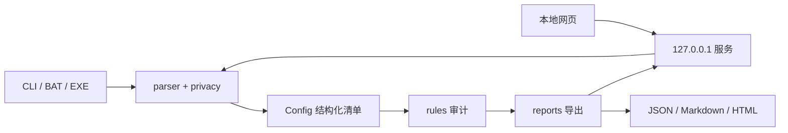

# 架构与扩展

NetAudit 在本机解析一台设备的配置文本，生成结构化清单和带证据的审计发现。CLI 与网页使用同一套解析、规则和报告代码；建议命令作为报告内容展示，没有连接设备、探测网络或自动下发配置的执行器。

## 目录与职责

下列路径均位于 [`network-config-auditor/`](../network-config-auditor/)：

| 文件或目录 | 职责 |
|---|---|
| [`netaudit/cli.py`](../network-config-auditor/netaudit/cli.py)、`__main__.py` | 参数解析、文件或标准输入、网页启动、报告输出及退出码；显式输出采用临时文件加原子替换，拒绝覆盖输入配置 |
| [`netaudit/parser.py`](../network-config-auditor/netaudit/parser.py) | 厂商识别、配置上下文、命令正反向变化、VLAN/接口/路由/ACL/NAT/管理面解析，保留未建模行与资源上限 |
| [`netaudit/model.py`](../network-config-auditor/netaudit/model.py) | `Config`、`Interface`、`ACLRule`、`Route`、`NAT`、`ManagementLine`、`Evidence` 和 `Finding` 数据类 |
| [`netaudit/privacy.py`](../network-config-auditor/netaudit/privacy.py) | 保留命令前遮蔽常见凭据，保留密码类型用于审计；不承诺覆盖所有敏感语法 |
| [`netaudit/rules.py`](../network-config-auditor/netaudit/rules.py) | `GenericPlugin` 基类、显式 `PLUGINS` 注册表及管理面、ACL、网络检查；每次审计创建新的插件实例 |
| [`netaudit/reports.py`](../network-config-auditor/netaudit/reports.py) | 同一个报告字典转为 JSON、Markdown 或 HTML，并转义用户可控的文本 |
| [`netaudit/server.py`](../network-config-auditor/netaudit/server.py) | 本地静态资源、会话令牌、HTTP 审计接口、请求限制、端口回退和浏览器调用 |
| [`netaudit/web/`](../network-config-auditor/netaudit/web/) | 中文界面、文件导入、示例、厂商选择、严重度筛选、清单展示与报告下载；无外部 CDN |
| [`tests/`](../network-config-auditor/tests/) | 解析、规则、报告、入口与便携行为验证 |
| [`tools/build_windows.py`](../network-config-auditor/tools/build_windows.py)、[`tools/smoke_portable.py`](../network-config-auditor/tools/smoke_portable.py) | 隔离构建、资源收集、Windows 源码/EXE 进程验收、许可证与校验和 |
| [`Start-NetAudit.bat`](../network-config-auditor/Start-NetAudit.bat)、[`tools/windows_entry.py`](../network-config-auditor/tools/windows_entry.py) | Windows BAT 的目录/Python/EXE 选择，以及冻结程序入口与重定向输出编码 |

## 数据流与边界

`parse_config(text, vendor)` 返回 `Config`。自动厂商识别依赖独有语法；证据不足或混合标记时要求明确厂商。证据 `Evidence.line` 从 1 开始，按原输入计数，命令文本在进入清单和报告前调用 `redact()`。未支持语法进入 `warnings`，实际数量由 `unsupported_count` 保存，展示最多 200 条。资源超限拒绝结果，避免使用部分清单作出完整结论。

模型以 `None` 表示很多未确认状态，例如接口 shutdown、VTY 入站协议、Trunk 显式允许列表。不能把缺失命令自动解释为某一设备版本的默认值。ACL 的 `complete=False` 表示含未建模条件；此类规则不参与覆盖推断。`ordered=False` 的 ACL 不推断前序遮蔽。VLAN 清单序列化为 `allowed_vlan_ranges` 闭区间：`null` 是未知，`[]` 是显式 none，`[[1,4094]]` 是 all。

`audit(config)` 运行注册插件，按严重度、规则 ID 与证据行号排序并生成报告。`confirmed-config` 表示配置证据明确，`needs-review` 表示需结合版本、拓扑或业务核对；两者都不能代替实时运行状态验证。规则区分 NAT 选流与过滤 ACL，按 VRF 比较重复地址，分别审查每个 VTY 段，允许同前缀 ECMP/浮动静态路由存在。

网页服务仅绑定 `127.0.0.1`，提供 `/`、`/app.js`、`/style.css`、`/api/session` 和 `/api/audit`。审计 POST 要求允许的 Host、同源 Origin、启动时生成的会话令牌与合法 JSON，最多同时进行四次审计。上传配置在请求中处理，不持久保存，也不记入请求日志；导出由用户主动保存。CLI 的 `--out` 写入用户指定目录，需保证该目录可写。

## 报告结构

现有 JSON 报告使用 `schema_version: "1.0"` 和 `tool_version: "0.1.0"`。这些字段由 `audit()` 生成；结构说明如下，详细语义和 VLAN 例子见 [项目说明](../network-config-auditor/README.md)。

| 顶层字段 | 内容 |
|---|---|
| `device` | 厂商、设备名、识别方式 |
| `summary` | 发现总数、各严重度数量、识别/相关/未建模行数 |
| `findings` | 规则 ID、严重度、类别、标题、问题、风险、建议、判断依据、证据和建议命令 |
| `inventory` | 解析后的接口、VLAN、路由、ACL、NAT、管理面及未建模信息 |
| `limitations` | 当前离线审计和语法覆盖的限制 |

Markdown、HTML 和网页都从这套结构生成。修改报告字段时同时检查四种使用方式，避免只改一个导出器。识别行数只反映已识别结构和命令范围，不能当作完整字段语义覆盖率或合规评分。

## 新增解析或规则

1. 使用最小合成配置明确目标厂商、命令上下文、`no` / `undo`、重复命令的覆盖顺序，以及未支持条件。扩展 `model.py` 时保留“未知”和“明确关闭/空集合”的区别。
2. 在 `parser.py` 加入解析，并保留正确的原始行号与脱敏证据。不要将无法理解的修饰符直接忽略后当作完全解析；需要时记录 warning 或 `complete=False`。
3. 规则在 `rules.py` 中继承 `GenericPlugin` 并加入 `PLUGINS`，或扩展现有插件。通过 `add()` 生成具有稳定规则 ID、风险说明、建议、证据和 confidence 的发现，不使用跨审计共享的可变状态。
4. 测试至少覆盖应报、应不报和未知/不完整情况，特别是 ACL 顺序与用途、VTY 分段、VRF 范围、业务合法配置。若修改涉及接口或网页，还应验证 CLI、HTTP 与三种导出使用同一结论。
5. 更新 [规则目录](../network-config-auditor/docs/RULES.md)、支持范围与必要的来源说明。修改建议是审阅模板，不添加自动设备修复功能。

## 源码与冻结运行

网页资源按 `Path(__file__).resolve().parent / "web"` 定位，不依赖当前工作目录。Python wheel 的 package-data 与 PyInstaller 的 `--add-data` 均保持 `netaudit/web` 相对目录；onedir 的运行库在整套目录中，迁移时不能只复制 EXE，onefile 使用系统默认临时目录。

无参数 CLI/EXE 启动服务并请求打开浏览器，`serve --no-browser` 保留自动化入口。BAT 优先使用同目录 EXE，否则检测 Python；参数调用传递退出码且不会等待暂停提示。报告输出为显式用户路径，运行时不需要向安装目录写配置或日志。构建和验收细节见 [开发说明](DEVELOPMENT.md)与 [PORTABILITY.md](../network-config-auditor/docs/PORTABILITY.md)。

许可证与上游归属分别见 [LICENSE](../network-config-auditor/LICENSE)、[NOTICE](../network-config-auditor/NOTICE)和 [UPSTREAM_AUDIT.md](../network-config-auditor/docs/UPSTREAM_AUDIT.md)；插件基类的改写来源需随代码和分发继续保留。
