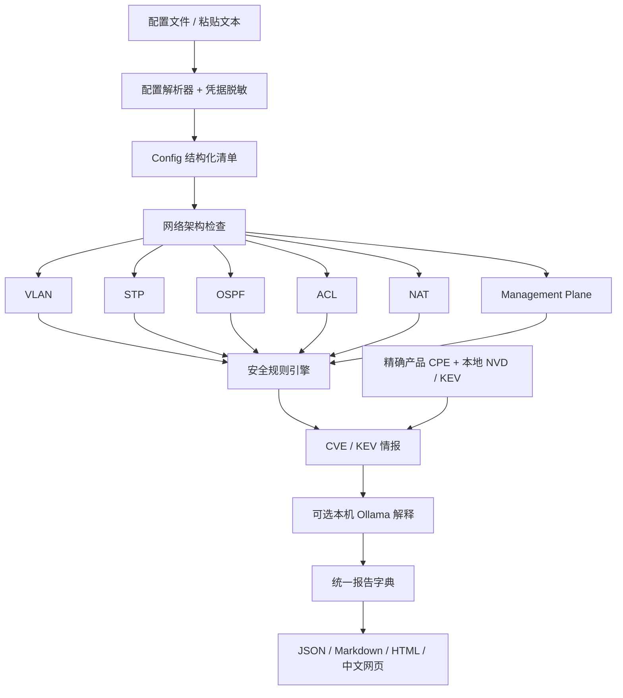

# 架构与扩展

NetAudit 在本机解析一台设备的配置文本，按配置解析、六域架构检查、安全规则、CVE / KEV、可选本机 AI 和报告输出组织审计。CLI、网页和便携 EXE 使用同一流程；建议命令作为报告内容展示，没有连接设备或下发配置的执行器。v0.2.0 的运行环境和实际验收以 [交付记录](../DELIVERY.md) 为准。

图中的阶段表示报告组织和处理顺序。架构检查产生的发现会与原有配置规则合并、统一排序；情报与 AI 使用独立字段，不覆盖配置证据或规则严重度。默认情报来自随包离线快照，AI 默认关闭。

## 目录与职责

下列路径均位于 [`network-config-auditor/`](../network-config-auditor/)：

| 文件或目录 | 职责 |
|---|---|
| [`netaudit/cli.py`](../network-config-auditor/netaudit/cli.py)、`__main__.py` | 参数、配置/情报文件、网页启动、显式情报更新、报告输出和退出码；显式输出采用临时文件加原子替换，拒绝覆盖输入资料 |
| [`netaudit/pipeline.py`](../network-config-auditor/netaudit/pipeline.py) | `audit_configuration()` 统一编排解析、架构/规则、情报、可选 AI 和流程状态 |
| [`netaudit/parser.py`](../network-config-auditor/netaudit/parser.py) | 厂商识别、命令上下文和正反向变化，VLAN/STP/OSPF/接口/路由/ACL/NAT/管理面解析，未建模行与资源上限 |
| [`netaudit/model.py`](../network-config-auditor/netaudit/model.py) | 配置、接口、ACL、路由、NAT、管理段、STP/OSPF 状态、证据与发现；区分未知和显式设置 |
| [`netaudit/privacy.py`](../network-config-auditor/netaudit/privacy.py) | 保留证据前遮蔽常见凭据，保留密码类型用于规则；不承诺覆盖所有敏感语法 |
| [`netaudit/architecture.py`](../network-config-auditor/netaudit/architecture.py) | 保守 STP / OSPF 检查，以及六个稳定架构领域的覆盖状态和关联发现 |
| [`netaudit/rules.py`](../network-config-auditor/netaudit/rules.py) | 保留 `GenericPlugin`、显式 `PLUGINS` 和原有规则，与架构发现合并；每次审计创建新插件实例 |
| [`netaudit/intelligence.py`](../network-config-auditor/netaudit/intelligence.py)、[`netaudit/data/`](../network-config-auditor/netaudit/data/) | 离线 KEV 来源、精确 CPE / 版本适用性核对、候选 CVE 和显式官方更新 |
| [`netaudit/ai.py`](../network-config-auditor/netaudit/ai.py) | 用户显式启用的本机 Ollama 解释、字段白名单、回环地址验证、输出限制与失败降级 |
| [`netaudit/reports.py`](../network-config-auditor/netaudit/reports.py) | 同一个报告字典转为 JSON、Markdown 或 HTML，展示阶段/架构/情报/AI，并转义可控文本 |
| [`netaudit/server.py`](../network-config-auditor/netaudit/server.py) | 本地资源、会话令牌、HTTP 审计、输入限制、端口回退和浏览器调用 |
| [`netaudit/web/`](../network-config-auditor/netaudit/web/) | 中文界面、导入/示例、严重度、六域覆盖、情报与 AI 设置、清单和下载；无外部 CDN |
| [`tests/`](../network-config-auditor/tests/) | 解析、规则、情报、AI、统一流程、报告、入口与便携行为验证 |
| [`tools/build_windows.py`](../network-config-auditor/tools/build_windows.py)、[`tools/smoke_portable.py`](../network-config-auditor/tools/smoke_portable.py) | 隔离构建、资源收集、源码/EXE 进程验收、来源/许可证与校验和 |
| [`Start-NetAudit.bat`](../network-config-auditor/Start-NetAudit.bat)、[`tools/windows_entry.py`](../network-config-auditor/tools/windows_entry.py) | Windows 目录/Python/EXE 选择、冻结入口、输出编码和退出码 |

## 数据流与边界

`parse_config(text, vendor)` 返回 `Config`。厂商独有证据不足或混合时要求明确选择；证据行号从 1 开始，按原输入计数，保留命令前调用 `redact()`。未支持语法进入 `warnings`，实际数量保留在 `unsupported_count`，最多展示 200 条。超限拒绝结果，避免以部分输入作出完整结论。

模型以 `None` 表示未确认的设置，例如 shutdown、VTY 协议、STP 启停、OSPF 认证和 VLAN 列表；缺失命令不能解释成某设备版本的默认值。ACL `complete=False` 或未知条件禁用覆盖推断，`ordered=False` 不推断前序遮蔽。VLAN 的 `allowed_vlan_ranges` 使用闭区间：`null` 是未知，`[]` 是显式 none，`[[1,4094]]` 是 all。

`rules.audit(config)` 执行架构检查和注册插件，统一排序，生成配置报告；保留原有底层调用方式。`pipeline.audit_configuration(text, vendor, ...)` 进一步核对本地情报、调用可选 AI，并生成完整流程。CLI 与 HTTP 都调用完整流程；没有情报输入仍会展示随包 KEV 来源和当前无法确认匹配的状态。

六域 `checked` 仅表示对已观察受支持配置进行了检查，`needs-review` 表示存在发现或相关未建模内容，`not-observed` 表示未观察到配置。STP 检查不证明根桥或环路，OSPF Network 用于选择接口，不等于实际发布整段地址；OSPF 检查不确认邻居、收敛或密钥有效性。规则 `confirmed-config` 表示配置证据明确，`needs-review` 表示还需版本、拓扑或业务复核。

情报需要用户提供精确 CPE 和本地 NVD CVE 2.0 数据。明确版本与受支持适用范围匹配时标注 `cpe-version-match`；未知版本、仅候选 CVE、复杂 AND/否定/环境条件或无法比较的版本保持待核对。KEV 表示漏洞已有现实利用记录，不证明当前设备受影响或已被入侵。来源、日期、覆盖和许可见 [情报说明](../network-config-auditor/docs/INTELLIGENCE.md)。

AI 只有显式启用、选定模型后才调用本机 Ollama，地址限制为回环地址。请求使用规则通用说明与情报事实的字段白名单，不发送原配置、设备清单、证据或凭据；具体字段和验证见 [AI 说明](../network-config-auditor/docs/AI.md)。AI 输出放在独立字段，不能改变规则、CVE 确认或严重度；超时、服务不可用或响应错误不会丢失审计报告。协议替身测试不能替代真实模型的输出质量验收。

## 报告结构

完整 v0.2.0 JSON 报告使用 `schema_version: "1.1"` 和 `tool_version: "0.2.0"`，保留旧字段，并增加阶段信息：

| 顶层字段 | 内容 |
|---|---|
| `device` | 厂商、设备名、识别方式 |
| `summary` | 配置发现和严重度数量、识别/相关/未建模行数；不是漏洞总数或安全评分 |
| `findings` | 规则 ID、严重度、类别、问题、风险、建议、确认程度、证据和建议命令 |
| `inventory` | 接口、VLAN、STP、OSPF/其他进程、路由、ACL、NAT、管理面和未建模信息 |
| `architecture` | 六域观察数量、覆盖边界、状态和关联规则 ID |
| `intelligence` | 离线数据来源、快照日期、产品版本匹配、候选及匹配限制 |
| `ai` | disabled / 请求结果或失败状态、模型信息与待人审解释 |
| `pipeline` | parser / architecture / security / intelligence / ai / reports 六个阶段的状态与说明 |
| `limitations` | 当前离线检查、情报与模型的限制 |

Markdown、HTML 和网页都从这套结构生成。修改字段时同步检查四种使用方式和已有调用者，避免只改一个导出器。识别行数只反映已识别命令范围，不能当作完整语义覆盖率或合规评分。

## 本地服务与数据保护

服务仅绑定 `127.0.0.1`，提供本地页面、资源、会话与审计 API。POST 要求允许的 Host、同源 Origin、会话令牌与合法 JSON，并限制并发审计。上传配置在请求中处理，不持久保存，也不记入请求日志；用户主动导出或 `--out` 才写报告，目标目录必须可写。

默认审计不联网。`intel-update` 是显式联网操作，只下载官方 KEV，不上传配置或资产；更新文件写用户指定位置或用户缓存/临时目录，不会改写随包快照。AI 请求仅访问用户显式启用的本机模型。程序可以从只读位置启动，导出和更新资料需选择可写位置。

## 新增解析或规则

1. 用合成配置明确目标厂商、上下文、`no` / `undo`、命令覆盖顺序和不完整条件，保留未知与明确关闭/空集合的区别。
2. 解析保留原始行号和脱敏证据；不能丢弃未知修饰符后假定完整解析，需要时记录 warning 或 `complete=False`。
3. 架构检查放在 `architecture.py`；常规规则继承 `GenericPlugin` 并加入 `PLUGINS`。生成稳定 ID、说明、建议、证据和确认程度，不使用跨审计共享可变状态。
4. 测试应报、应不报与未知情况，关注合法的服务器 Trunk、被动 OSPF、VRF 边界、ACL 用途/顺序和 VTY 分段；情报测试复杂条件降级，AI 测试本机限制和失败报告。
5. 更新 [规则目录](../network-config-auditor/docs/RULES.md)、支持范围和来源。建议是审阅模板，不添加自动设备修复。

## 源码与冻结运行

网页与 KEV 数据按模块所在目录定位，不依赖工作目录。Python wheel 的 package-data 与 PyInstaller 资源收集均保持 `netaudit/web` 和 `netaudit/data` 相对目录。onedir 迁移必须复制整个文件夹；onefile 解压到用户临时目录。

无参数 CLI/EXE 启动服务并打开浏览器，`serve --no-browser` 保留自动化入口。BAT 优先同目录 EXE，否则检测 Python；参数调用返回退出码且不会暂停。资源、许可和验收细节见 [开发说明](DEVELOPMENT.md)与 [PORTABILITY.md](../network-config-auditor/docs/PORTABILITY.md)。

原 [LICENSE](../network-config-auditor/LICENSE)、[NOTICE](../network-config-auditor/NOTICE)和 [上游审计](../network-config-auditor/docs/UPSTREAM_AUDIT.md)继续保留；新增官方情报来源与数据许可随包提供。
